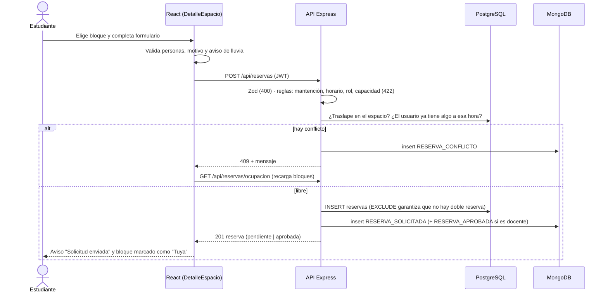
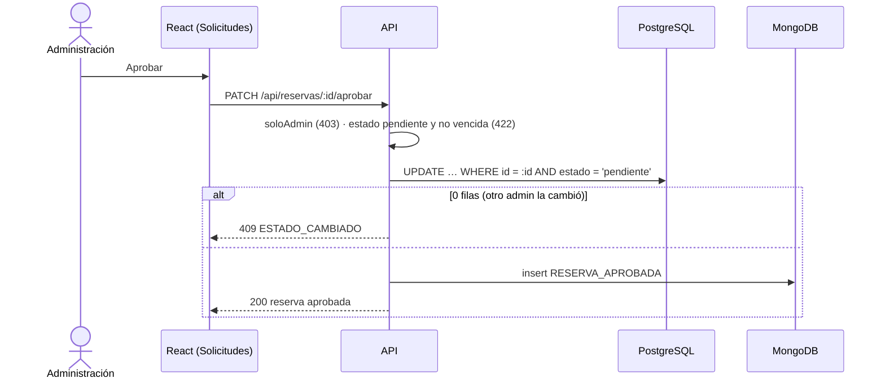

# Diseño y planificación — Reservas UNAB · Hito 3

Documento de la sección 6 del enunciado: diagnóstico del Taller 2, alcance ampliado, historias de
usuario, modelos de datos, arquitectura, flujos, endpoints y navegación.

## 1. Diagnóstico del Taller 2

| Aspecto | Situación en el Taller 2 | Problema | Decisión para el Hito 3 |
|---|---|---|---|
| Datos de usuarios, sedes y espacios | JSON fijos en `src/data` | No se pueden administrar; cambiar una sala obliga a editar código | Tablas en PostgreSQL + CRUD desde la página *Administración* |
| Reservas | Estado de React + `localStorage` | No se comparten entre usuarios ni dispositivos; se pierden al borrar el navegador | Tabla `reservas` en PostgreSQL vía API |
| Conflictos de horario | Solo se evitaban en la interfaz | Dos navegadores podían reservar el mismo bloque | Validación en el servicio + restricción `EXCLUDE` en la base |
| Login | Lista de RUT sin contraseña y sin dígito verificador | Cualquiera podía entrar con un RUT ajeno | Contraseña con bcrypt, JWT, validación del dígito verificador |
| Ciclo de vida | La reserva se creaba confirmada y no se podía cancelar | No hay control de la administración | Estados pendiente / aprobada / rechazada / cancelada |
| Seguimiento | No existía | No se sabe quién hizo qué ni cuánto se usan los espacios | Eventos en MongoDB + panel de indicadores |

**Elementos reutilizados**: componentes `TarjetaEspacio`, `BarraOcupacion`, `SelectorHorario`,
`FormularioReserva`, `Modal`, `PanelClima`, `IconoClima`, `EstadoVacio`, `Notificaciones`; utilidades de
fechas, RUT y clima; servicio y hook de Open-Meteo; todo el sistema visual (variables CSS, tarjetas,
estados de color).

## 2. Alcance ampliado

### Actores

| Actor | Nuevo | Necesidades |
|---|---|---|
| Estudiante | No | Encontrar un espacio libre, solicitarlo, saber si fue aprobado, cancelarlo |
| Docente | No | Reservar sin esperar aprobación, ver y cancelar sus reservas |
| Organización estudiantil | No | Reservar espacios grandes/exteriores para actividades, con aviso de lluvia |
| **Administración de espacios** | **Sí** | Mantener el inventario de edificios, salas y equipamiento; revisar solicitudes; conocer el uso; auditar cambios |

### Procesos

1. **Administrar infraestructura**: sedes (catálogo) → edificios → espacios (tipo, capacidad, piso, equipamiento, estado).
2. **Solicitar reserva**: buscar → ver disponibilidad → solicitar → validaciones → `pendiente` o `aprobada`.
3. **Revisar solicitudes**: bandeja → aprobar o rechazar con motivo.
4. **Cancelar**: el dueño (o la administración) antes de que comience.
5. **Consultar historial**: reservas propias pasadas y línea de tiempo de cada una.
6. **Medir utilización**: indicadores por período y sede.
7. **Auditar**: bitácora de eventos.

## 3. Historias de usuario priorizadas

| # | Prioridad | Historia | Criterios de aceptación |
|---|---|---|---|
| HU1 | Alta | Como **usuario** quiero iniciar sesión con mi RUT y contraseña para que mis reservas queden a mi nombre. | RUT con dígito verificador válido; error genérico si falla; la sesión se mantiene al recargar; expira a las 8 h |
| HU2 | Alta | Como **usuario** quiero ver qué espacios están libres por sede, tipo, fecha y capacidad. | Filtros combinables; barra de ocupación del día; espacios en mantención visibles pero no reservables |
| HU3 | Alta | Como **estudiante** quiero solicitar un bloque y que el sistema impida reservar algo ocupado. | Duración máxima por rol; personas ≤ capacidad; motivo ≥ 5 caracteres; 409 si el bloque se tomó; queda pendiente |
| HU4 | Alta | Como **administración** quiero aprobar o rechazar solicitudes pendientes. | Bandeja filtrable; rechazo con motivo obligatorio; no se aprueba algo ya vencido ni dos veces |
| HU5 | Alta | Como **usuario** quiero ver mis reservas y cancelar las que no necesito. | Próximas e historial; estado visible; cancelación con confirmación; el bloque se libera |
| HU6 | Alta | Como **administración** quiero administrar edificios, salas, laboratorios y su equipamiento. | CRUD con validaciones; no borrar lo que tiene datos relacionados; cambiar estado a mantención/inactivo |
| HU7 | Media | Como **docente** quiero que mi reserva se confirme de inmediato. | Rol docente → `aprobada` sin pasar por la bandeja |
| HU8 | Media | Como **usuario** quiero ver el historial de una reserva (quién la aprobó, cuándo, por qué se rechazó). | Línea de tiempo con los eventos de MongoDB |
| HU9 | Media | Como **administración** quiero un panel con indicadores de uso. | Ocupación, aprobación, cancelación, tiempo de respuesta, top espacios, uso por tipo y por hora; filtro por período y sede |
| HU10 | Media | Como **administración** quiero saber qué espacios se piden y no se pueden dar. | Conteo de intentos con conflicto por espacio (MongoDB) |
| HU11 | Baja | Como **administración** quiero una bitácora de actividad. | Lista paginada de eventos, filtrable por categoría |
| HU12 | Baja | Como **organización** quiero saber si lloverá antes de reservar un espacio exterior. | Se mantiene el aviso de lluvia del Taller 2 |

## 4. Modelo de dominio

```
Sede 1───* Edificio 1───* Espacio *───1 TipoEspacio
                              │  *
                              │  └──* EspacioEquipamiento *──1 Equipamiento
                              │1
                              *
Rol 1───* Usuario 1───* Reserva (estado: pendiente → aprobada | rechazada → cancelada)
                 └ 0..1 revisa ┘

Evento (MongoDB) ──referencia──► Reserva | Espacio | Edificio | Equipamiento | Usuario
```

### Estados de una reserva

```
                 rol requiere aprobación
   [solicitud] ──────────────────────────► PENDIENTE ──rechazar (admin, con motivo)──► RECHAZADA
        │                                     │
        │ rol sin aprobación                  │ aprobar (admin, antes del inicio)
        ▼                                     ▼
     APROBADA ◄───────────────────────────────┘
        │
        │ cancelar (dueño o admin, antes del inicio)   ← también desde PENDIENTE
        ▼
     CANCELADA
```

Solo `pendiente` y `aprobada` **ocupan** el bloque.

## 5. Modelo entidad-relación (PostgreSQL)

Ver diagrama en el README (sección 6.1) y el script `database/postgres/01_esquema.sql`.

| Tabla | Propósito | Restricciones clave |
|---|---|---|
| `roles` | Reglas por tipo de usuario | `max_horas_reserva` 1–13, nombre/slug únicos |
| `usuarios` | Personas con acceso | RUT único con formato válido, email único, FK a rol |
| `sedes` | Campus y coordenadas (clima) | latitud/longitud en rango |
| `edificios` | Ubicación física | `UNIQUE (sede_id, nombre)`, pisos 1–50 |
| `tipos_espacio` | Catálogo (icono y color de la UI) | nombre único |
| `espacios` | Salas, laboratorios, etc. | código único, capacidad 1–500, estado en lista cerrada |
| `equipamiento` | Catálogo de equipos | nombre único |
| `espacio_equipamiento` | N:M con cantidad | PK compuesta, borrar equipo asignado = `RESTRICT` |
| `reservas` | Transacción principal | horario 08–21, fin > inicio, motivo ≥ 5, rechazo con motivo, **EXCLUDE sin traslape** |

**Normalización**: 3FN. La ubicación se obtiene por `espacio → edificio → sede` (sin duplicar la sede
en el espacio). El equipamiento es una relación N:M con atributo (`cantidad`).

## 6. Diseño NoSQL (MongoDB)

**Necesidad del dominio**: trazabilidad. La administración necesita saber quién aprobó, rechazó o
canceló, cuándo y por qué; qué cambió en un espacio; y cuánta demanda no se pudo atender.

**Colección `eventos`** (un documento por hecho, nunca se modifica):

| Campo | Tipo | Descripción |
|---|---|---|
| `tipo` | string | `RESERVA_SOLICITADA`, `RESERVA_CONFLICTO`, `ESPACIO_ACTUALIZADO`, … |
| `categoria` | enum | `reserva` · `infraestructura` · `sesion` |
| `fecha` | date | Momento del hecho |
| `actor` | objeto \| null | Copia de `usuarioId`, `nombre`, `rol` al momento del hecho |
| `entidad` | objeto | `tipo`, `id` (id SQL) y `etiqueta` legible |
| `detalle` | objeto libre | Distinto según el tipo (cambios antes/después, motivo, horario del intento, etc.) |
| `origen` | objeto | IP y navegador |

**Índices**: `{fecha:-1}`, `{entidad.tipo, entidad.id, fecha}`, `{actor.usuarioId, fecha:-1}`,
`{categoria, tipo, fecha:-1}`. **Validación**: `$jsonSchema` en la colección.

**Consultas**: línea de tiempo de una entidad · feed paginado por cursor (`_id < último`) · aggregation
`$group` por tipo · aggregation de conflictos por espacio.

**Por qué documental y no SQL**: el `detalle` es heterogéneo, los registros son inmutables y de alto
volumen, se consultan por tiempo/entidad sin *joins*, y se guardan hechos que en SQL no existen (intentos
fallidos y valores anteriores a una edición). El `actor` se copia a propósito: el historial debe mostrar el
nombre/rol que tenía la persona en ese momento.

## 7. Arquitectura y flujos

### Crear una reserva



### Aprobar una solicitud



## 8. Diseño de endpoints

| Método | Ruta | Propósito | Entrada | Salida |
|---|---|---|---|---|
| POST | `/api/auth/login` | Autenticar | `{rut, password}` | `{token, usuario}` |
| GET | `/api/auth/perfil` | Usuario de la sesión | — | `Usuario` |
| GET | `/api/sedes` | Catálogo de sedes | — | `Sede[]` |
| GET | `/api/tipos-espacio` | Catálogo de tipos | — | `TipoEspacio[]` |
| GET | `/api/edificios` | Listar | `?sedeId` | `Edificio[]` |
| POST / PUT | `/api/edificios[/:id]` | Crear / editar | `{sedeId, nombre, direccion?, pisos}` | `Edificio` |
| DELETE | `/api/edificios/:id` | Eliminar (sin espacios) | — | 204 |
| GET | `/api/equipamiento` | Listar | — | `Equipamiento[]` |
| POST / PUT | `/api/equipamiento[/:id]` | Crear / editar | `{nombre, icono?}` | `Equipamiento` |
| DELETE | `/api/equipamiento/:id` | Eliminar (no asignado) | — | 204 |
| GET | `/api/espacios` | Buscar | `?sedeId&tipoId&edificioId&capacidadMin&q&estado&incluirInactivos` | `Espacio[]` |
| GET | `/api/espacios/:id` | Detalle | — | `Espacio` |
| POST / PUT | `/api/espacios[/:id]` | Crear / editar | `{codigo, nombre, tipoId, edificioId, piso, capacidad, exterior, estado, descripcion?, equipamiento[]}` | `Espacio` |
| DELETE | `/api/espacios/:id` | Eliminar (sin reservas) | — | 204 |
| GET | `/api/espacios/:id/disponibilidad` | Bloques de un día | `?fecha` | `{bloques[{hora, estado}]}` |
| GET | `/api/reservas/ocupacion` | Ocupación de una sede | `?sedeId&fecha` | `BloqueOcupado[]` |
| GET | `/api/reservas/mias` | Reservas personales | `?alcance&estado` | `Reserva[]` |
| GET | `/api/reservas` | Todas (admin) | `?estado&fecha&desde&hasta&sedeId&espacioId` | `Reserva[]` |
| POST | `/api/reservas` | Solicitar | `{espacioId, fecha, horaInicio, duracion, personas, motivo}` | `Reserva` (201) |
| GET | `/api/reservas/:id` | Detalle | — | `Reserva` |
| GET | `/api/reservas/:id/historial` | Línea de tiempo (MongoDB) | — | `Evento[]` |
| PATCH | `/api/reservas/:id/aprobar` | Aprobar | — | `Reserva` |
| PATCH | `/api/reservas/:id/rechazar` | Rechazar | `{motivo}` | `Reserva` |
| PATCH | `/api/reservas/:id/cancelar` | Cancelar | `{motivo?}` | `Reserva` |
| GET | `/api/indicadores` | Panel | `?desde&hasta&sedeId` | `Indicadores` |
| GET | `/api/actividad` | Bitácora (admin) | `?categoria&tipo&usuarioId&antesDe&limite` | `Evento[]` |
| GET | `/api/actividad/mia` | Actividad propia | `?antesDe&limite` | `Evento[]` |
| GET | `/api/salud` | Estado de servicios | — | `{estado, postgres, mongo}` |

El contrato completo (esquemas, ejemplos y respuestas de error) está en `backend/src/docs/openapi.yaml`
y se navega en Swagger UI.

## 9. Mapa de navegación actualizado

```
                       ┌───────────┐
                       │   Login   │  RUT + contraseña
                       └─────┬─────┘
                             ▼
   ┌──────────────────── Barra superior (según rol) ──────────────────────┐
   │                                                                       │
   ▼                 ▼                 ▼               ▼          ▼           ▼
Espacios       Mis reservas      Solicitudes*   Administración*  Indicadores*  Actividad*
filtros+clima  próximas/historial pendientes     espacios        KPI + gráficos bitácora
tarjetas       cancelar          aprobar/rechazar edificios       por período    MongoDB
   │           historial (modal) historial        equipamiento    y sede
   ▼                                              (modales CRUD)
Modal horarios → formulario → aviso
                                                   * solo Administración
```

**Cambios en la experiencia respecto del Taller 2**:

- Login con contraseña, botón para mostrarla y lista desplegable de usuarios de prueba.
- Barra de navegación por secciones (se desplaza horizontalmente en el celular).
- Nuevo estado de bloque **"En revisión"** (naranja con rayas) para solicitudes pendientes de otras personas.
- El botón del formulario dice *Enviar solicitud* o *Confirmar reserva* según el rol, y se explica si quedará pendiente.
- Estados de **carga** (skeleton), **error** (mensaje + *Reintentar*), **vacío** y **éxito** (avisos) en todas las páginas que consultan la API.
- Confirmación antes de cancelar, rechazar o eliminar.
