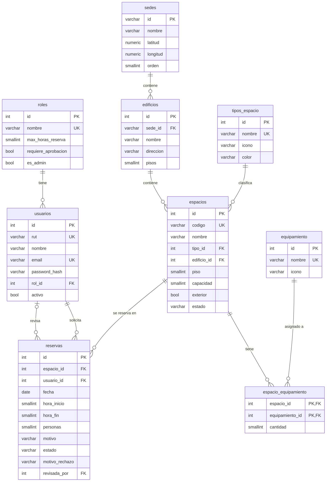

# Reservas UNAB · Plataforma Full Stack

Sistema de gestión y reserva de espacios universitarios.
**Hito 3 · Desarrollo Web y Móvil · Segundo Semestre 2026** — caso *3.1 Gestión de espacios universitarios*.

Es la evolución del prototipo React del Taller Evaluado 2 (carpeta `Entrega-2`): ahora tiene una
**API REST propia**, persistencia en **PostgreSQL** y **MongoDB**, documentación **Swagger/OpenAPI** y
se ejecuta completo con **Docker Compose**.

## Integrantes

- Zaid Isamit Alvial
- Agustin Carmona
- Jhon Rojas

---

## 1. Problema y usuarios

En la universidad hay salas de clases, laboratorios, salas de estudio, salas de reunión y espacios
al aire libre repartidos en varias sedes. No existe un lugar único para saber cuáles están libres,
pedir una reserva y que alguien la apruebe, ni datos para saber qué tanto se usan.

| Usuario | Qué hace en el sistema |
|---|---|
| **Estudiante** | Reserva salas de estudio o laboratorios (máx. 2 h). Su solicitud queda *pendiente* hasta que la administración la apruebe. |
| **Docente** | Reserva salas y laboratorios para clases o ayudantías (máx. 4 h). Su reserva se aprueba de inmediato. |
| **Organización estudiantil** | Reserva salas de reunión y espacios exteriores (máx. 3 h). Requiere aprobación. |
| **Administración de espacios** *(nuevo actor)* | Administra edificios, salas, laboratorios y equipamiento; aprueba o rechaza solicitudes; revisa indicadores de uso y la bitácora de actividad. |

## 2. Continuidad con el Taller 2

| | Taller 2 (Entrega-2) | Hito 3 (Entrega-3) |
|---|---|---|
| Datos | Archivos JSON en `src/data` y `localStorage` | PostgreSQL (datos operacionales) + MongoDB (eventos) a través de la API |
| Inicio de sesión | Lista fija de RUT, sin contraseña ni validación del dígito verificador | RUT con dígito verificador + contraseña (bcrypt), sesión con JWT |
| Reservas | Se creaban al instante en el navegador; no se podían cancelar | Flujo **solicitud → aprobación / rechazo → cancelación**, con estados |
| Conflictos de horario | Se evitaban solo en la interfaz | Validados en el backend **y** garantizados por una restricción `EXCLUDE` de PostgreSQL |
| Vistas | Login y catálogo | + Mis reservas, Solicitudes, Administración, Indicadores y Actividad |
| Clima (Open-Meteo) | Panel, bloques y aviso de lluvia | Se **mantiene** igual (ver sección 8) |

**Se conserva**: el caso, los usuarios, el diseño visual (paleta, tipografía, tarjetas, barra de
ocupación, modal de horarios), el formateo del RUT, las reglas de duración por rol y la API de clima.
**Se modifica**: la fuente de los datos (de JSON a la API) y el login. **Se amplía**: el actor
administración, el ciclo de vida de la reserva, la administración de infraestructura, los
indicadores y la auditoría.

## 3. Funcionalidades obligatorias del caso 3.1

| Requisito del enunciado | Dónde está |
|---|---|
| Administración de edificios, salas y laboratorios | *Administración* → pestañas Salas y laboratorios / Edificios / Equipamiento (CRUD completo) |
| Capacidad, equipamiento, ubicación y disponibilidad | Cada espacio tiene capacidad, equipamiento con cantidad (tabla N:M), sede + edificio + piso, y estado `disponible` / `mantencion` / `inactivo` |
| Solicitudes, aprobación, rechazo y cancelación | Estados `pendiente → aprobada / rechazada → cancelada`. Bandeja *Solicitudes* (administración) y *Mis reservas* (usuario) |
| Validación de conflictos de horario | Servicio de reservas (409 con mensaje claro) + restricción `reservas_sin_traslape` en PostgreSQL. Tampoco se permite que una persona tenga dos reservas a la misma hora |
| Reservas personales e historial | *Mis reservas* (próximas / historial, filtro por estado) + línea de tiempo de cada reserva leída desde MongoDB |
| Panel e indicadores de utilización | *Indicadores*: ocupación, aprobación, cancelación, tiempo de respuesta, espacios más usados, uso por tipo, demanda por hora y demanda no atendida |
| **SQL**: usuarios, edificios, espacios, equipamiento y reservas | `database/postgres/01_esquema.sql` |
| **NoSQL**: eventos de reserva, auditoría o actividad | Colección `eventos` de MongoDB (sección 6) |

## 4. Arquitectura

```
                      ┌──────────────────────────────┐
  Navegador ─────────►│  frontend (nginx :8080)      │
                      │  React 19 + Vite (compilado) │
                      └──────┬───────────────┬───────┘
                 /api/* (proxy)              │ HTTPS (directo desde el navegador)
                             ▼               ▼
                ┌────────────────────┐   ┌──────────────────────┐
                │ backend (:3000)    │   │ Open-Meteo (pública) │
                │ Express 5 · JWT    │   └──────────────────────┘
                │ Swagger /api/docs  │
                └──────┬─────────┬───┘
                       │         │
            ┌──────────▼───┐ ┌───▼──────────┐
            │ PostgreSQL 16│ │  MongoDB 7   │
            │ estado actual│ │  eventos     │
            └──────────────┘ └──────────────┘
```

El backend está separado en capas:

```
backend/src/
├── server.js            Arranque, conexión (con reintentos) a las dos bases y apagado limpio
├── app.js               Express: helmet, CORS, JSON, Swagger, rutas y manejo de errores
├── config/              env.js (variables de entorno) · postgres.js (pool, transacciones) · mongo.js (colección + validador + índices)
├── routes/index.js      Mapa de endpoints → middlewares → controladores
├── middlewares/         autenticacion.js (JWT, solo admin) · validar.js (Zod) · manejoErrores.js
├── schemas/             DTO de entrada con Zod (auth, infraestructura, reservas, reportes)
├── controllers/         Traducen HTTP ↔ servicio (no tienen lógica de negocio)
├── services/            Reglas de negocio (reglasReserva.js son funciones puras testeables)
├── repositories/        SQL parametrizado (PostgreSQL) y consultas/aggregations (MongoDB)
├── utils/               errores, RUT, fecha/hora en America/Santiago
└── docs/openapi.yaml    Contrato OpenAPI 3 que publica Swagger UI
```

El frontend separa páginas, componentes, servicios HTTP, hooks y contexto:

```
frontend/src/
├── services/     http.js (fetch + token + ApiError) · authApi · infraestructuraApi · reservasApi · reportesApi · climaApi
├── context/      SesionContext (usuario + token) · NotificacionesContext
├── hooks/        useConsulta (estados cargando/ok/error + reintentar) · useClima
├── pages/        Login · Espacios · MisReservas · Solicitudes · Administracion · Panel · Actividad
├── components/   Tarjetas, modal, formularios, gráficos, línea de tiempo, estados vacío/carga/error…
└── utils/        fechas, RUT, clima, ocupación de bloques, formatos
```

Los diagramas de secuencia, el modelo de dominio y las historias de usuario están en
[`Documentacion/Diseno_Hito3.md`](Documentacion/Diseno_Hito3.md).

## 5. Tecnologías

| Capa | Tecnología | Versión |
|---|---|---|
| Frontend | React · React Router · Vite | 19.x · 7.x · 8.x |
| Estilos | Bootstrap · Bootstrap Icons · CSS propio | 5.3 · 1.13 |
| Backend | Node.js · Express | 22 · 5.x |
| Validación | Zod | 3.x |
| Seguridad | jsonwebtoken (JWT) · bcryptjs · helmet · cors | 9.x · 3.x · 8.x · 2.x |
| SQL | PostgreSQL (driver `pg`) | 16 · 8.x |
| NoSQL | MongoDB (driver oficial `mongodb`) | 7 · 6.x |
| Documentación API | OpenAPI 3.0 · swagger-ui-express | 3.0.3 · 5.x |
| Ejecución | Docker · Docker Compose · nginx | — · v2 · 1.27 |
| Pruebas | `node:test` (incluido en Node) | 22 |

## 6. Datos

### 6.1 Modelo relacional (PostgreSQL)



Restricciones importantes:

- `reservas_sin_traslape`: `EXCLUDE USING gist (espacio_id WITH =, fecha WITH =, int4range(hora_inicio, hora_fin) WITH &&) WHERE (estado IN ('pendiente','aprobada'))`.
  **La base de datos impide la doble reserva** aunque dos personas confirmen en el mismo instante.
- `CHECK` en capacidad (1–500), horario (08–21, `hora_fin > hora_inicio`), estados válidos, rechazo con motivo y formato del RUT.
- Claves foráneas con `ON DELETE RESTRICT` para no perder el historial (un espacio con reservas no se borra: se marca *inactivo*).
- Índices por usuario/fecha y por fecha/estado para las consultas más comunes.

Los scripts `database/postgres/01_esquema.sql` y `02_datos_prueba.sql` se ejecutan solos la primera
vez que se levanta el contenedor. Las fechas de las reservas de prueba son relativas a `CURRENT_DATE`.

### 6.2 MongoDB: colección `eventos`

Cada acción relevante genera un documento:

```json
{
  "_id": "6728f0c2a1b2c3d4e5f60718",
  "tipo": "RESERVA_RECHAZADA",
  "categoria": "reserva",
  "fecha": "2026-11-04T15:20:11.000Z",
  "actor": { "usuarioId": 4, "nombre": "Coordinación de Espacios", "rol": "Administrador" },
  "entidad": { "tipo": "reserva", "id": 21, "etiqueta": "Cancha multiuso · 2026-11-04 19:00–20:00" },
  "detalle": { "estadoAnterior": "pendiente", "motivo": "Evento institucional", "solicitante": "Agustin Carmona" },
  "origen": { "ip": "172.18.0.5", "userAgent": "Mozilla/5.0 …" }
}
```

Tipos: `RESERVA_SOLICITADA`, `RESERVA_APROBADA`, `RESERVA_RECHAZADA`, `RESERVA_CANCELADA`,
`RESERVA_CONFLICTO`, `ESPACIO_CREADO/ACTUALIZADO/ESTADO_CAMBIADO/ELIMINADO`, `EDIFICIO_*`,
`EQUIPAMIENTO_*`, `SESION_INICIADA`, `SESION_FALLIDA`.

La colección se crea al iniciar la API con un **validador `$jsonSchema`** y cuatro índices
(`fecha`, `entidad.tipo+entidad.id+fecha`, `actor.usuarioId+fecha`, `categoria+tipo+fecha`).

**Funcionalidades reales que la usan:**

1. **Historial de cada reserva** (*Mis reservas* y *Solicitudes* → botón *Historial*): `GET /api/reservas/:id/historial`.
2. **Bitácora de auditoría** (*Actividad*, con filtro y paginación por cursor): `GET /api/actividad`.
3. **Demanda no atendida** en *Indicadores*: aggregation que cuenta los intentos de reserva rechazados
   por conflicto de horario (`RESERVA_CONFLICTO`) por espacio.

**Por qué un modelo documental y por qué no es duplicación:**

- PostgreSQL guarda **el estado actual** (una fila por reserva, que cambia de `pendiente` a `aprobada`).
  MongoDB guarda **la historia**: una secuencia inmutable de hechos (*append-only*) que no se actualiza ni se borra.
- Cada tipo de evento tiene **datos distintos** (`detalle` de una edición tiene `cambios: {campo: {antes, despues}}`,
  el de un rechazo tiene `motivo`, el de un login fallido no tiene reserva). En SQL obligaría a una tabla con
  muchas columnas nulas o a una tabla por tipo.
- Guarda información que **no existe en SQL**: los intentos fallidos (conflictos, logins fallidos) nunca llegan a
  ser una fila, y los valores anteriores de una edición se pierden en SQL al hacer `UPDATE`.
- Es un volumen que **crece rápido** y se consulta por tiempo y por entidad, sin *joins*, que es justo para lo que
  sirven los índices de MongoDB.

Si MongoDB no está disponible, la operación principal en PostgreSQL igual se completa (el registro del
evento es *best effort* y se informa en el log del servidor); `GET /api/salud` reporta el estado de ambas bases.

## 7. API REST y Swagger

- **Swagger UI**: http://localhost:3000/api/docs (también desde el frontend: http://localhost:8080/api/docs)
- Especificación JSON: http://localhost:3000/api/docs.json
- Para probar: `POST /auth/login` → copiar `token` → botón **Authorize**.

| Método | Ruta | Quién | Para qué |
|---|---|---|---|
| GET | `/api/salud` | público | Estado de la API, PostgreSQL y MongoDB |
| POST | `/api/auth/login` | público | Iniciar sesión (RUT + contraseña) → JWT |
| GET | `/api/auth/perfil` | sesión | Usuario actual |
| GET | `/api/sedes` · `/api/tipos-espacio` | sesión | Catálogos |
| GET · POST · PUT · DELETE | `/api/edificios[/:id]` | admin escribe | CRUD de edificios |
| GET · POST · PUT · DELETE | `/api/equipamiento[/:id]` | admin escribe | CRUD de equipamiento |
| GET · POST · PUT · DELETE | `/api/espacios[/:id]` | admin escribe | CRUD de espacios con filtros (sede, tipo, capacidad, texto, estado) |
| GET | `/api/espacios/:id/disponibilidad?fecha=` | sesión | Estado de cada bloque horario |
| GET | `/api/reservas/ocupacion?sedeId=&fecha=` | sesión | Bloques ocupados de una sede (sin datos personales de otros) |
| GET | `/api/reservas/mias?alcance=proximas\|historial\|todas` | sesión | Reservas personales |
| GET | `/api/reservas` | admin | Todas las reservas con filtros |
| POST | `/api/reservas` | sesión | Solicitar reserva |
| GET | `/api/reservas/:id` · `/api/reservas/:id/historial` | dueño o admin | Detalle e historial (MongoDB) |
| PATCH | `/api/reservas/:id/aprobar` · `/rechazar` | admin | Revisar solicitud |
| PATCH | `/api/reservas/:id/cancelar` | dueño o admin | Cancelar |
| GET | `/api/indicadores?desde=&hasta=&sedeId=` | admin | Panel de utilización (SQL + MongoDB) |
| GET | `/api/actividad` · `/api/actividad/mia` | admin · sesión | Bitácora (MongoDB) |

**Códigos de respuesta**: `200/201/204` éxito · `400` datos inválidos (con detalle por campo) ·
`401` sin sesión · `403` sin permiso · `404` no existe · `409` conflicto (doble reserva, duplicado,
registro en uso, cambio concurrente) · `422` regla de negocio (duración, capacidad, mantención,
horario pasado…) · `500` error interno **sin detalles** (el detalle solo queda en el log del servidor).

Formato de error:

```json
{ "error": { "codigo": "DURACION_EXCEDIDA", "mensaje": "Tu rol (Estudiante) permite reservar como máximo 2 horas seguidas." } }
```

### Reglas de negocio

| Regla | Respuesta |
|---|---|
| No se puede reservar un bloque ya tomado (pendiente o aprobado) del mismo espacio | 409 + evento `RESERVA_CONFLICTO` |
| Una persona no puede tener dos reservas que se crucen | 409 |
| Duración máxima por rol (2 / 3 / 4 / 8 h) | 422 `DURACION_EXCEDIDA` |
| Personas ≤ capacidad del espacio | 422 `CAPACIDAD_EXCEDIDA` |
| Solo espacios `disponible` (no en mantención ni inactivos) | 422 `ESPACIO_EN_MANTENCION` |
| Bloques futuros, entre 08:00 y 21:00, con máx. 60 días de anticipación | 422 |
| Estudiante/organización → `pendiente`; docente/administración → `aprobada` | — |
| Solo se aprueba/rechaza lo `pendiente`; una solicitud vencida se puede rechazar pero no aprobar | 422 |
| Rechazar exige motivo (lo ve el solicitante) | 400 |
| Solo el dueño o la administración cancelan, y antes de que empiece | 403 / 422 |
| No se elimina un edificio con espacios, un equipamiento asignado ni un espacio con reservas | 409 |

## 8. API pública: Open-Meteo (se mantiene)

| | |
|---|---|
| API | Open-Meteo Weather Forecast API — documentación: https://open-meteo.com/en/docs |
| Endpoint · método | `https://api.open-meteo.com/v1/forecast` · `GET` |
| Datos | `hourly.temperature_2m`, `hourly.precipitation_probability`, `hourly.weather_code` para la latitud/longitud de la sede (ahora vienen de la tabla `sedes` de PostgreSQL) |
| Dónde se usa | Panel de clima, clima por bloque horario, aviso de lluvia obligatorio al reservar espacios exteriores y etiqueta "riesgo de lluvia" en las tarjetas |
| Integración | **Desde el frontend** (`frontend/src/services/climaApi.js`) |
| Errores | Estado de carga (skeleton), mensaje de error con *Reintentar*, aviso "pronóstico no disponible" para fechas a más de 16 días; peticiones canceladas con `AbortController` y caché por sede+fecha |
| Clave | No requiere clave, por lo que no hay secretos en el repositorio |

**Decisión**: la mantuvimos porque sigue aportando valor al caso (avisar lluvia antes de reservar un
espacio exterior) y la dejamos en el frontend porque es información **complementaria**: no participa en
ninguna regla del backend, no necesita clave que esconder, y si falla la reserva sigue funcionando.
Pasarla por el backend solo agregaría un salto de red sin beneficio.

## 9. Cómo ejecutar

### Con Docker Compose (recomendado)

Requisitos: Docker Desktop (o Docker Engine + Compose v2).

```bash
cd Entrega-3
docker compose up --build
```

| Servicio | URL / puerto |
|---|---|
| Aplicación web | http://localhost:8080 |
| API | http://localhost:3000/api |
| Swagger | http://localhost:3000/api/docs |
| PostgreSQL | `localhost:5432` (usuario `reservas`, base `reservas_unab`) |
| MongoDB | `localhost:27017` (base `reservas_unab`) |

- La primera vez PostgreSQL crea las tablas y carga los datos de prueba; la API crea la colección de MongoDB.
- El orden de arranque está controlado con `healthcheck` + `depends_on` (postgres y mongo → backend → frontend).
- **Si un puerto está ocupado**, cámbialo sin editar archivos: `API_PORT=3001 WEB_PORT=8081 docker compose up --build`
  (o define esas variables en un `.env`, ver `.env.example`).
- **Volver a los datos iniciales**: `docker compose down -v` (borra los volúmenes) y luego `docker compose up`.

### Sin Docker (modo desarrollo)

Se necesita Node.js 22+, y PostgreSQL 16 y MongoDB 7 corriendo localmente (o solo las bases con
`docker compose up postgres mongo`).

```bash
# 1. Base de datos (solo si no usas Docker para PostgreSQL)
psql -U postgres -c "CREATE USER reservas WITH PASSWORD 'cambiar_esta_clave'"
psql -U postgres -c "CREATE DATABASE reservas_unab OWNER reservas"
psql -U postgres -d reservas_unab -f database/postgres/01_esquema.sql
psql -U postgres -d reservas_unab -f database/postgres/02_datos_prueba.sql

# 2. API
cd backend
cp .env.example .env        # ajustar DATABASE_URL, MONGO_URL y JWT_SECRET
npm install
npm run dev                 # http://localhost:3000/api/docs

# 3. Frontend (otra terminal)
cd frontend
npm install
npm run dev                 # http://localhost:5173 (Vite redirige /api a localhost:3000)
```

### Variables de entorno

| Archivo | Variable | Descripción |
|---|---|---|
| `.env.example` (raíz, para Compose) | `POSTGRES_DB`, `POSTGRES_USER`, `POSTGRES_PASSWORD`, `POSTGRES_PORT` | Base PostgreSQL |
| | `MONGO_DB`, `MONGO_PORT` | Base MongoDB |
| | `API_PORT`, `JWT_SECRET`, `JWT_EXPIRES_IN` | API |
| | `WEB_PORT` | Puerto del frontend |
| `backend/.env.example` | `PORT`, `DATABASE_URL`, `MONGO_URL`, `MONGO_DB`, `JWT_SECRET`, `JWT_EXPIRES_IN`, `CORS_ORIGINS`, `APP_TIMEZONE` | API fuera de Docker |
| `frontend/.env.example` | `VITE_API_PROXY` | URL de la API para `npm run dev` |

Los valores por defecto del `docker-compose.yml` son **solo de desarrollo**. Ningún `.env` real se
sube al repositorio (`.gitignore`).

### Usuarios de prueba (contraseña `unab2026`)

| RUT | Nombre | Rol |
|---|---|---|
| 21.668.839-2 | Zaid Isamit Alvial | Docente |
| 21.993.115-8 | Agustin Carmona | Estudiante |
| 21.834.824-6 | Jhon Rojas | Organización Estudiantil |
| 11.111.111-1 | Coordinación de Espacios | Administrador |
| 12.345.678-5 | María Pérez (ficticia) | Estudiante |
| 15.987.654-3 | Pedro Soto (ficticio) | Docente |

## 10. Guion de demostración (sección 8 del enunciado)

1. **Flujo completo desde React**: entrar como *Agustin (Estudiante)* → *Espacios* → *Ver horarios* → elegir bloque → enviar solicitud (queda *pendiente*). Salir, entrar como *Administrador* → *Solicitudes* → *Aprobar*. Volver como Agustin → *Mis reservas*: aparece *Aprobada*.
2. **Persistencia en PostgreSQL**: recargar la página o abrir otro navegador: la reserva sigue ahí. `docker compose exec postgres psql -U reservas -d reservas_unab -c "SELECT id, fecha, hora_inicio, estado FROM reservas ORDER BY id DESC LIMIT 3;"`
3. **MongoDB**: botón *Historial* de la reserva (línea de tiempo) y página *Actividad*. `docker compose exec mongo mongosh reservas_unab --eval "db.eventos.find().sort({_id:-1}).limit(3)"`
4. **Regla de negocio**: intentar reservar un bloque ya tomado → mensaje "ya está reservado…" (409), los horarios se actualizan y en *Indicadores → Demanda no atendida* aparece el intento.
5. **Swagger**: http://localhost:3000/api/docs → `POST /auth/login` → *Authorize* → `POST /reservas`.
6. **Error/validación**: login con contraseña incorrecta; en el formulario de reserva dejar el motivo vacío; como estudiante pedir 3 horas por Swagger (422 `DURACION_EXCEDIDA`).
7. **Docker Compose**: `docker compose ps` muestra los 4 servicios *healthy/running*.

## 11. Pruebas

```bash
cd backend
npm test                                       # 25 pruebas unitarias: reglas de negocio, RUT y esquemas
API_URL=http://localhost:3000/api npm run test:e2e   # 22 pruebas de integración contra la API levantada
```

Las pruebas de integración usan PostgreSQL y MongoDB reales y cubren: login correcto/incorrecto, 401/403,
reserva de docente (aprobada) y de estudiante (pendiente), **doble reserva (409)**, duración y capacidad
(422), aprobación, aprobación repetida, cancelación ajena (403), cancelación propia, historial en MongoDB
con los 3 eventos, registro del conflicto en MongoDB, CRUD de espacio, espacio en mantención (422) e
indicadores. Al terminar cancelan lo que crearon, por lo que se pueden ejecutar varias veces.

Además se verificó manualmente:

- 6 solicitudes simultáneas al mismo bloque → 1 creada, 5 rechazadas con 409.
- Un `INSERT` directo en PostgreSQL que se traslapa es rechazado por la restricción `reservas_sin_traslape`.
- Recorrido de todas las páginas en Chrome (escritorio 1366 px y celular 390 px) sin errores en consola.

## 12. Limitaciones conocidas

- No hay registro de usuarios ni recuperación de contraseña: los usuarios se crean en los datos de prueba.
- Las reservas son por bloques de hora completa (08:00–21:00); no hay reservas recurrentes (por ejemplo, "todos los lunes").
- No se envían correos ni notificaciones push; el usuario ve el resultado en *Mis reservas* (las notificaciones se proyectan para el Hito 4).
- Si MongoDB cae, las operaciones siguen funcionando pero esos eventos no quedan registrados.
- El token JWT se guarda en `localStorage` (simple para el proyecto; en producción convendría una cookie `httpOnly`).
- El pronóstico del clima cubre solo 16 días.
- Las reservas de prueba cargadas por SQL no tienen historial en MongoDB (se crearon antes de que existiera el registro).

## 13. Git y colaboración

Se mantiene la estrategia de ramas del Taller 2: `main` (entregas), `develop` (integración) y una rama
`feature/*` por funcionalidad que vuelve a `develop` mediante Pull Request.

| Rama sugerida | Contenido |
|---|---|
| `feature/modelo-datos` | Esquema SQL, datos de prueba y Docker Compose de las bases |
| `feature/api-base` | Estructura del backend, configuración, errores y Swagger |
| `feature/api-infraestructura` | Edificios, espacios, equipamiento |
| `feature/api-reservas` | Reservas, reglas de negocio y conflictos |
| `feature/mongo-eventos` | Colección de eventos, historial, actividad e indicadores |
| `feature/front-integracion` | Servicios HTTP, sesión con JWT y catálogo conectado |
| `feature/front-reservas` | Mis reservas, solicitudes e historial |
| `feature/front-admin` | Administración, indicadores y actividad |
| `feature/docker-docs` | Dockerfiles, README y diseño |

## 14. Uso de Inteligencia Artificial
Aspectos visuales, organizacion de archivos y ayuda en el codigo. 
Ocupamos Claude Code.

## 15. Estructura del proyecto

```
Entrega-3/
├── docker-compose.yml        4 servicios: postgres, mongo, backend, frontend
├── .env.example              Variables de Compose (opcional)
├── README.md
├── Documentacion/
│   ├── Enunciado_Hito_3_Desarrollo_Web_Movil_corregido.docx
│   └── Diseno_Hito3.md       Diagnóstico, historias de usuario, modelos, flujos y endpoints
├── database/postgres/
│   ├── 01_esquema.sql        Tablas, claves, CHECK, EXCLUDE e índices
│   └── 02_datos_prueba.sql   Datos de prueba
├── backend/                  API REST (ver sección 4)
│   ├── Dockerfile · .env.example · package.json
│   ├── src/ …
│   └── tests/                Unitarias (*.test.js) e integración (e2e/*.e2e.js)
└── frontend/                 React (evolución de Entrega-2)
    ├── Dockerfile · nginx.conf · .env.example · package.json
    └── src/ …
```
